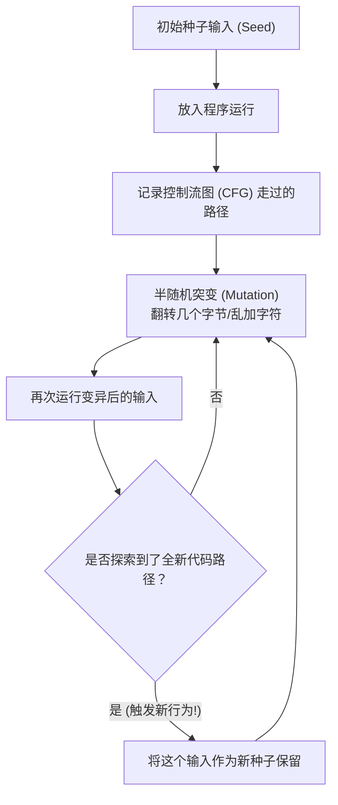
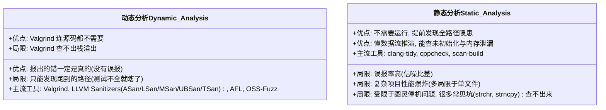

# CS110L 第 2 讲：程序分析（Program Analysis）—— 找 Bug 的艺术与局限

> **课程主题**：如何用自动化工具找出 C/C++ 程序中的错误？这些工具有什么强大的本领，又有什么不可逾越的致命弱点？  
> **面向对象**：哪怕你是零基础初中生，只要跟着本文由浅入深的逻辑，也能轻松看懂！

---

## 目录

1. [引子：找 Bug 为什么像捉迷藏？](#1-引子找-bug-为什么像捉迷藏)
2. [第一大阵营：动态分析（Dynamic Analysis）—— 边跑边看](#2-第一大阵营动态分析dynamic-analysis边跑边看)
   - [2.1 什么是动态分析？](#21-什么是动态分析)
   - [2.2 神兵利器一：Valgrind（二进制实时插桩）](#22-神兵利器一valgrind二进制实时插桩)
   - [2.3 为什么 Valgrind 查不出“栈溢出”？内存栈结构揭秘](#23-为什么-valgrind-查不出栈溢出内存栈结构揭秘)
   - [2.4 神兵利器二：LLVM Sanitizers（源码级编译器消毒器）](#24-神兵利器二llvm-sanitizers源码级编译器消毒器)
   - [2.5 动态分析的致命软肋：你看不到没发生的事](#25-动态分析的致命软肋你看不到没发生的事)
   - [2.6 自动轰炸机：Fuzzing（模糊测试）](#26-自动轰炸机fuzzing模糊测试)
3. [第二大阵营：静态分析（Static Analysis）—— 不运行代码的“老中医”](#3-第二大阵营静态分析static-analysis不运行代码的老中医)
   - [3.1 什么是静态分析？](#31-什么是静态分析)
   - [3.2 基础篇：Linting（代码吸尘器）](#32-基础篇linting代码吸尘器)
   - [3.3 进阶篇：数据流分析（Dataflow Analysis）](#33-进阶篇数据流分析dataflow-analysis)
   - [3.4 实战推演：活跃性分析（Liveness Analysis）与跨函数分析](#34-实战推演活跃性分析liveness-analysis与跨函数分析)
   - [3.5 静态分析的死穴：误报、性能爆炸与停机问题](#35-静态分析的死穴误报性能爆炸与停机问题)
   - [3.6 两个“看似小儿科”却团灭静态分析工具的代码案例](#36-两个看似小儿科却团灭静态分析工具的代码案例)
4. [核心总结与下节预告：通往 Rust 的大门](#4-核心总结与下节预告通往-rust-的大门)

---

## 1. 引子：找 Bug 为什么像捉迷藏？

在编程的过程中，对于编写完的代码，我们常常需要进行审查，来确保其正确和安全。

而在长时间的与debug搏斗的过程中，计算机科学家们想出了两大招数：

1. **动态分析（Dynamic Analysis）**：把程序真正运行起来，给它塞各种输入，一边跑一边拿放大镜盯着它。
2. **静态分析（Static Analysis）**：一口气都不跑，直接阅读代码，用瞪眼法挑毛病。

---

## 2. 第一大阵营：动态分析（Dynamic Analysis）—— 边跑边看

### 2.1 什么是动态分析？
>
> **通俗比喻**：就像新车出厂前的“碰撞测试”或者“试驾”。测试员坐进车里猛踩油门、急刹车，看看刹车灵不灵、气囊会不会弹出来。

**动态分析的特点**：

- 必须实际运行程序，观察它在运行过程中的一举一动。
- 检查程序有没有非法访问内存、有没有泄漏资源。

---

### 2.2 神兵利器一：Valgrind（二进制实时插桩）

在动态分析的世界里，名气最大的工具之一叫做 **Valgrind**（其中最常用的工具组件叫 `memcheck`）。

#### 它有多神奇？

通常情况下，如果我们想检查程序，必须拿到源代码。但 Valgrind 极其霸道：**它连源代码都不需要！** 你扔给它一个已经编译好的可执行文件（比如 `a.out`），它就能直接查！

#### 它是怎么工作的？

Valgrind 就像一个“卧底特工”，在程序执行的瞬间给代码偷偷“加料”：

1. **拆解机器码（反汇编）**：把编译好的二进制可执行文件拆解成类似汇编的中间步骤。
2. **秘密插桩（Instrumentation）**：在每一条关键指令周围，偷偷塞进自己的监视代码（比如：“报告长官，这行代码刚才向内存写了一个字节！”）。
3. **逐块重新编译执行**：把加了料的代码重新打包成机器码，在 CPU 上一小块一小块地运行。

#### 看个真实代码例子

```c
int main() {
    char *buf = (char*)malloc(8); // 向操作系统申请了 8 个字节的堆内存
    buf[16] = 'a';                // 只申请了 8 个，你却写到了第 16 个！
}
```

普通的编译器可能根本不报错，程序甚至可能“侥幸”运行成功。但 Valgrind 在运行时会记录：

- `malloc(8)`：记录你只借了 8 块砖。
- 随后它发现你试图在第 16 块砖的位置写入字符 `'a'`。
- Valgrind 瞬间抓包并报警：  
  `Invalid write of size 4`（无效写入！你写入了堆空间，但这块空间根本没有分配给你！）。

#### 幕后黑科技：影子内存（Shadow Metadata）

Valgrind 的 `memcheck` 会在后台维护一份“秘密账本”（称为**影子内存**）。内存里的每一个字节，在账本上都有对应的标记位：

- **这个字节有没有被初始化？**（如果是未经赋值的垃圾数据，你读它就报警！）
- **这个字节有没有被释放（freed）？**（如果已经归还了你还用，或者同一块内存归还了两次，立刻报警！）

---

### 2.3 为什么 Valgrind 查不出“栈溢出”？内存栈结构揭秘

既然 Valgrind 这么牛，那是不是所有内存错误它都能找出来？**并不是！**  
它有一个致命的盲区：**它查不出“栈上的缓冲区溢出”（Stack-based buffer overflow）！**

为什么呢？这要从计算机内存的“栈”（Stack）说起。

#### 知识点补充：什么是栈帧（Stack Frame）？

在计算机运行函数时，每次调用一个函数，就会在内存里开辟一块空间，叫**栈帧**：

1. **栈的生长方向**：栈是从**高地址向低地址“倒着向下长”**的（就像水井，越挖越深）。
2. **基准指针与栈指针**：
   - `rbp` 寄存器存着当前函数栈帧的“基地”（基准指针）。
   - 局部变量被放在基准指针的下方，例如 `mov QWORD PTR [rbp-8], rax`（意思是：“把变量存到基地往下一个抽屉”）。
3. **但是！数组写数据的方向却是“向上”（向高地址）长的！**

```text
高地址 (High addresses)
┌──────────────────────────────────────┐
│  函数参数 (Function parameters)      │
├──────────────────────────────────────┤
│  返回地址 (Return address - 函数完返回哪)│
├──────────────────────────────────────┤
│  保存的基指针 (Saved base pointer)   │ <--- rbp 指针指向这里
├──────────────────────────────────────┤
│  局部变量 (Local variables)          │
│  [buf 数组] 写入方向往上 ↑             │
│                                      │
└──────────────────────────────────────┘ <--- 栈顶指针 (低地址 Low addresses)
低地址 (Low addresses)
```

#### 为什么 Valgrind 瞎了？

在编译后的二进制文件里，**所有变量名（比如 `int a`, `char buf[8]`）全都消失了！**  
二进制代码里只有一整大块内存区域叫做“栈”。CPU 只知道这里有一大片连续地址，但根本不知道哪 8 个字节是 `buf`，哪 4 个字节是变量 `x`。  
如果你在栈上的 `buf[8]` 数组里写了 16 个字节，多出来的字节只是踩到了旁边的其他局部变量，甚至踩到了返回地址。  
在 Valgrind 看来，你依然是在合法的“栈”内部写数据！它根本不知道你已经越界踩到了隔壁邻居！

---

### 2.4 神兵利器二：LLVM Sanitizers（源码级编译器消毒器）

Valgrind 因为是在**编译之后**才介入，丢失了源代码的信息。  
那科学家们就想：**如果我们在编译的最早阶段（看得到源代码的时候）就下手呢？**  
这便是 **LLVM Sanitizers（消毒器）**！它直接内置在现代编译器（如 Clang / LLVM）中。

#### 它的优势

编译器在看源代码时，清清楚楚地知道：

- “这个数组名字叫 `buf`，大小刚好是 8 字节！”
因此编译器可以直接在代码中植入检查逻辑：

```c
int main() {
    char buf[8];
    // 编译器插桩：悄悄登记栈缓冲区 buf，大小为 8
    buf[16] = 'a';
    // 编译器插桩：检查这次写入的偏移量是 16，超出了 8！立即抓现行！
}
```

不仅能轻松捕捉栈溢出，而且因为是编译器原生支持，运行速度比 Valgrind 快很多！

#### Sanitizer 各个部分

| 消毒器名称 | 缩写 | 抓捕目标 |
| :--- | :--- | :--- |
| **AddressSanitizer** | **ASan** | **内存非法地址**：越界读写（堆、栈、全局变量）、重复释放（Double Free）、释放后使用（Use After Free） |
| **LeakSanitizer** | **LSan** | **内存泄漏**：借了内存没还 |
| **MemorySanitizer** | **MSan** | **未初始化内存**：读了没填值的随机垃圾数据 |
| **UndefinedBehaviorSanitizer** | **UBSan** | **未定义行为**：空指针解引用、整数溢出、除以零等 |
| **ThreadSanitizer** | **TSan** | **多线程竞态**：多个线程打架争抢同一份数据 |


---

### 2.5 动态分析的致命软肋

所有动态分析工具都有一个无法打破的死穴：  
**它只能报告“在这次运行中真正发生了”的错误！如果你的测试输入没有触发那个 Bug，它就装作什么事都没发生！**

看下面这个将小写转大写的经典 C 代码：

```c
#include <stdio.h>
#include <string.h>

int main() {
    char s[100];
    int i;
    printf("\nEnter a string : ");
    gets(s); // 极度危险的输入函数！不检查输入有多长！
    for (i = 0; s[i]!='\0'; i++) {
        if(s[i] >= 'a' && s[i] <= 'z') {
            s[i] = s[i] - 32;
        }
    }
    printf("\nString in Upper Case = %s", s);
    return 0;
}
```

- **平时测试**：你输入 `"hello"`，长度只有 5，装在 100 字节的数组里轻轻松松。Valgrind 和 Sanitizer 都会开心地打绿色的勾，告诉你：“没有任何 Bug！”
- **真实生产环境**：恶意用户或者不小心敲入了一个 200 字符的长句子，`gets(s)` 瞬间击穿内存，系统崩溃！
- **结论**：只要测试输入不够刁钻，动态分析就会给你虚假的安全感。

---

### 2.6 自动轰炸机：Fuzzing（模糊测试）

既然人工输入很难想到所有刁钻古怪的极端情况（Edge cases），那能不能让机器自己瞎蒙测试？  
这就是 **Fuzzing（模糊测试）**！



1. **核心逻辑**：
   - 拿一个合法的输入文件作为“种子”（Seed）。
   - 让程序跑一遍，记录它走了哪些分支代码（控制流图 CFG）。
   - 对种子进行“基因变异”（比如随机翻转某个二进制位、插入特殊符号、截断等）。
   - 再跑一遍！如果这个变异输入让程序**跑进了以前从未去过的新代码分支**，说明有戏！就把这个输入存下来作为新的优质种子。
   - 重复这个过程一万次、一亿次，直到程序崩溃！
2. **主流工具**：`AFL (American Fuzzy Lop)`、`libfuzzer`。
3. **业界标杆**：谷歌的 **OSS-Fuzz**，搭建了庞大的服务器集群，24 小时全年无休地给全球主流开源软件狂轰滥炸找 Bug。
4. **局限性**：依然没有“数学保证”！如果你跑了 24 小时没报错，只能证明它这 24 小时没找到，也许再跑 10 秒钟它就崩了呢？

---

## 3. 第二大阵营：静态分析（Static Analysis）—— 不运行代码的“老中医”

既然“边跑边看”总是测不全，那咱们干脆**不运行程序**，直接去“看”代码！

### 3.1 什么是静态分析？

静态分析就像在考前审卷子。代码一行都不需要跑，分析器通过解析源代码的语法树、逻辑结构，直接推断代码是否存在隐患。

---

### 3.2 基础篇：Linting（代码吸尘器）

#### 名字的古老渊源

1978 年，贝尔实验室的 Stephen C. Johnson 发明了世界上第一个 `lint` 程序。  
`lint` 在英文里原本是指**衣服烘干机滤网里滤出的细小毛絮**。这个工具就像滤网一样，专门滤掉代码中微小但可能引发大灾难的脏东西。

#### 它是怎么工作的？

初级的 Linter 用的技术非常朴素（甚至接近文本搜索 Ctrl+F 或正则表达式）：

- 它根据人类预先配置好的一套“规矩”（Rules）进行检查。
- 例如：“禁止在代码里调用 `strcpy`！”、“花括号必须换行对齐！”
- **注意**：Linter 报错，**不代表程序一定会崩**。比如你在确保目标数组足够大的情况下调用 `strcpy` 是完全安全的，但 Linter 依然会严厉警告你。
- **代表工具**：`clang-tidy`（非常强大，不仅能报出代码坏味道，甚至很多问题能**一键自动修复 auto-fix**）。

---

### 3.3 进阶篇：数据流分析（Dataflow Analysis）

高级的静态分析可不仅仅是“文本搜索”，它懂得**推演程序的未来**！  
**数据流分析**会顺着代码的所有可能执行路径，像福尔摩斯一样推算每一个变量可能拥有的值或状态集合。

#### 经典案例：被遗忘的初始化

请看下面这段代码，你能看出问题吗？

```c
int main(int argc, char *argv[]) {
    printf("Enter a string to make uppercase, or type \"quit\" to quit:\n");
    char input[512];
    fgets(input, sizeof(input), stdin);

    char *toMakeUppercase; // 注意：此时指针处于【未初始化】状态！

    if (strcmp(input, "quit") != 0) {
        toMakeUppercase = input; // 只有用户输入的不是 "quit" 时，才给它赋值！
    }

    printToUpper(toMakeUppercase); // 危险！
}
```

#### 数据流分析器的思维过程

1. 一开始：`toMakeUppercase = {未初始化 (uninitialized)}`。
2. 遇到 `if` 分支：
   - 路径 A（输入不是 quit）：`toMakeUppercase = {input 指针}`。
   - 路径 B（输入是 quit）：跳过 if，此时 `toMakeUppercase` 依然是 `{未初始化}`。
3. 汇合点（执行 `printToUpper` 前）：  
   分析器合并所有可能状态：`toMakeUppercase = {未初始化, input}`。
4. 报警发现！  
   `printToUpper called with a possibly uninitialized argument!`  
   （警告：你传给函数的指针，在某种情况下可能是个未初始化的野指针！）

像 `clang-tidy` 这样的工具就能轻松完成这种推演。

---

### 3.4 实战推演：活跃性分析（Liveness Analysis）与跨函数分析

#### 什么是活跃性分析（Liveness Analysis）？

它专门观察：**一个变量在什么时候“死掉”（不再被使用了）**。如果变量已经寿终正寝，但它之前借的内存资源却没有被清理，那就是内存泄漏！

#### 案例拆解：解析括号字符串

目标：把类似 `"[target string]"` 中括号里的内容提取出来。

```c
int main(int argc, char *argv[]) {
    char *parsed = strdup(argv[1]); // 在堆上复制了一份字符串（需要手动 free！）

    // 寻找左括号 '['
    char *open_bracket = strchr(parsed, '[');
    if (open_bracket == NULL) {
        printf("Malformed input!\n");
        return 1; // 🚨 常见灾难：直接提前 return，忘记 free(parsed) 了！
    }

    parsed = open_bracket + 1; // 让指针往后移

    // 寻找右括号 ']'
    char *close_bracket = strchr(parsed, ']');
    if (close_bracket == NULL) {
        printf("Malformed input!\n");
        return 1; // 🚨 同样：提前退出，造成内存泄漏！
    }

    *close_bracket = '\0';
    printf("Parsed string: %s\n", parsed);
    free(parsed); // 这里虽然 free 了，但前面提前 return 的路径全部漏掉了！
    return 0;
}
```

**活跃性分析怎么看？**  
在第一个 `return 1` 的位置，变量 `parsed` 的生命周期结束了（is no longer live），但是它身上绑定的**堆内存分配**（heap allocation）却没有释放！分析器直接抓现行。

#### 还能更厉害：跨函数数据流分析（Interprocedural Analysis）

如果把资源释放藏在另一个子函数里，分析器还看得清吗？

```c
void freeSometimes(void *buf) {
    if (rand() == 1) { // 有一半概率直接溜掉
        return;
    }
    free(buf); // 另一半概率释放内存
}

int main() {
    void *buf = malloc(8);
    freeSometimes(buf);
    return 0;
}
```

分析器顺藤摸瓜钻进 `freeSometimes`：

- 分支 1：直接返回，`buf` 状态为 `{仍然被占用 heap allocation}`。
- 分支 2：执行释放，`buf` 状态为 `{已释放 freed allocation}`。
- 退出函数回到 `main` 时，合并状态：`buf = {heap allocation, freed allocation}`。
- 编译器发出严厉警告：  
  `Potential leak of memory pointed to by 'buf'`（变量 buf 在某些执行路径下可能发生内存泄漏！）。

---

### 3.5 静态分析的死穴：误报、性能爆炸与停机问题

既然静态分析连“未来未发生的事”都能推算出来，为什么我们不能只靠它？

1. **死穴一：误报（False Positives）—— 静态分析的“阿喀琉斯之踵”**
   - 分析器很笨，它会穷举所有语法分支，**哪怕某些条件在现实物理世界中根本不可能同时成立！**
   - 比如代码写着 `if (x > 5) { ... } if (x < 2) { ... }`，有些复杂逻辑结合后是死分支，分析器却当真了，拼命给你报“可能出错”。
   - 如果一个工具报了 100 个错误，其中 99 个都是假的（信噪比低），程序员就会彻底失去耐心，直接把分析器卸载。
2. **死穴二：性能与范围爆炸**
   - 跨函数推演很美好，但如果项目有几千万行代码、无数层函数调用、复杂递归循环，分析所有可能路径所需的计算量会呈指数级爆炸！
   - 因此，**绝大多数现实中的静态分析器只能“管好单文件”（Single file）**，不敢跨文件甚至跨深层函数分析。
3. **理论天花板：计算机科学的不可能定理 —— 停机问题（The Halting Problem）**
   - 计算机之父阿兰·图灵早就证明过：**世界上不存在任何一个通用的算法，能在不运行程序的前提下，完全准确地判断任意程序是否会出现某种行为（比如停机或出错）。**

---

### 3.6 两个“看似小儿科”却团灭静态分析工具的代码案例

课件给出了两个极具启发性的“低垂果实”（Low-hanging fruit）案例。在这两个最简单的短代码面前，业界最顶尖的三大静态检查工具（`clang-tidy`、`cppcheck`、`scan-build`）**全部失灵，一致汇报“代码毫无问题”！**

#### 翻车案例 #1：找不到的字符

```c
int main(int argc, char *argv[]) {
    char *message = strchr(argv[1], 'a'); // 在命令行参数中寻找字符 'a'
    printf("%s\n", message);
}
```

- **潜伏炸弹**：如果用户传入的参数里根本没有字母 `'a'`，`strchr` 会返回 **`NULL`（空指针）**！紧接着 `printf("%s")` 读取空指针，程序瞬间 Segmentation Fault 崩溃！
- **三大工具的表现**：全部亮绿灯，0 个警告！
- **为什么工具不敢管？**
  - 如果分析器强制要求“每次调用 `strchr` 都必须检查 NULL”，那如果程序员明确知道传进来的字符串一定有 `'a'` 呢？那就会产生无穷无尽的“误报”。
  - 库里还有成百上千个可能返回 NULL 的函数，全报一遍，程序员就疯了。

#### 翻车案例 #2：消失的字符串结束符 `\0`

```c
int main(int argc, char *argv[]) {
    char buf[16];
    strncpy(buf, argv[1], sizeof(buf)); // 把参数拷贝到 buf 里
    printf("%s\n", buf);
}
```

- **潜伏炸弹**：C 语言的 `strncpy` 有一个历史巨坑——**如果源字符串长度超过了限制（$\ge 16$ 字节），它拷贝完之后根本不会在末尾加 `\0`（空字符终止符）！**
- 这意味着 `buf` 根本不是一个合法的 C 语言字符串！接下来的 `printf("%s", buf)` 会盲目地在内存里一直往后读，直到偶尔撞见一个 `0` 为止。这会造成严重的**越界读取信息泄漏**（震惊全球的 OpenSSL“心脏滴血 Heartbleed”漏洞就是类似原理！）。
- **三大工具的表现**：再次集体眼瞎，全部汇报 0 错误！
- **为什么工具不管？** 因为在 C 语言看来，`buf` 也可以被当成一个单纯的“字符数组”（byte buffer）使用，而不是“C 字符串”。编译器根本猜不透程序员到底想干嘛。

---

## 4. 核心总结与下节预告：通往 Rust 的大门

回顾本节课，我们学习了 C/C++ 找 Bug 的两大招数：



### 终极拷问

1. **如果你写 C/C++ 代码**：请务必将消毒器（Sanitizers）、模糊测试（Fuzzing）和静态分析器（Static Analyzers）常态化集成到你的项目中。哪怕它们有局限，也远比纯肉眼找 Bug 强一万倍！
2. **然而，根本问题依然存在**：
   为什么静态分析器在看那几行代码时这么吃力？  
   **因为 C 语言的类型系统太简陋了！它无法表达任何前置条件与后置条件（契约）。编译器根本不知道这一小块代码的上下文边界。**

> **灵魂发问**：  
> 有没有可能设计这样一种全新的编程语言——  
> 让我们**只需要孤立地看一小段代码**，编译器就能通过极其严谨的语法规则，在**编译阶段**以 100% 的确定性保证：**它绝不会发生内存泄漏、绝不会出现悬垂指针、绝不会发生缓冲区溢出？**

**答案就是：Rust 语言！🦀**  
下一讲，我们将正式推开 Rust 的大门，领略彻底终结这些内存噩梦的终极武器 —— **所有权系统（Ownership Model）**！
